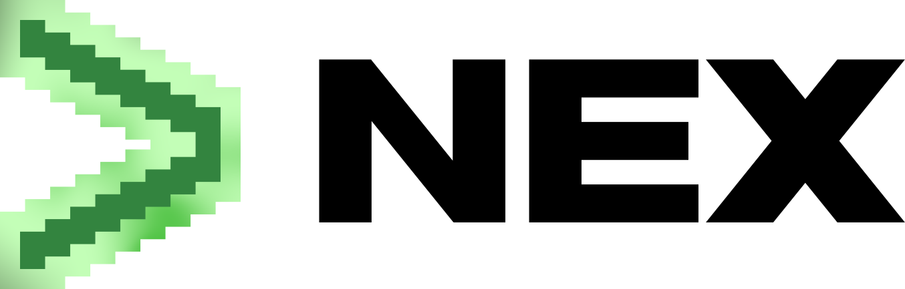
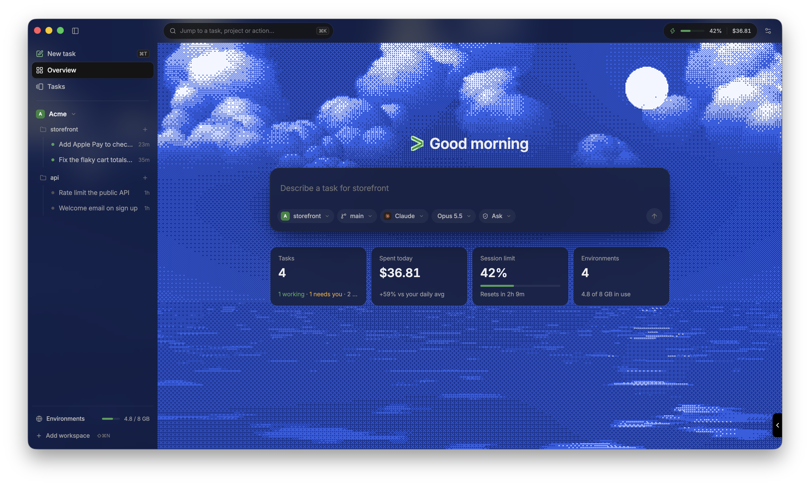

<p align="center">
  <picture>
    <source media="(prefers-color-scheme: dark)" srcset="src/web/assets/brand/nex-wordmark-white.svg">
    
  </picture>
</p>

<p align="center">
  Run Claude Code on many tasks at once, each in its own worktree and environment.
  <br><br>
  <a href="https://github.com/carl0shd/nex/releases/latest">Download</a>
  ·
  <a href="#building">Building</a>
  ·
  <a href="CONTRIBUTING.md">Contributing</a>
  ·
  <a href="CHANGELOG.md">Changelog</a>
</p>

<p align="center">
  
</p>

## About

Nex is a macOS app for working with Claude Code in parallel. Describe a task and Nex gives it a branch,
a worktree and an isolated environment with its own databases, then runs Claude Code headless inside it.
You follow every task side by side, answer what Claude asks, review the diff and move on to the next.

Nex drives the real `claude` CLI, so your models, permissions, subagents and sessions work as they do in
the terminal.

## Download

Get the latest `.dmg` from [Releases](https://github.com/carl0shd/nex/releases/latest). Nex needs a Mac
with Apple silicon and Claude Code 2.1 or later; task environments need macOS 26.

Nex is not notarized yet. After moving it to Applications, allow the first launch with
`xattr -dr com.apple.quarantine /Applications/Nex.app`.

## Building

```bash
pnpm install
pnpm dev
```

See [CONTRIBUTING.md](CONTRIBUTING.md) for the toolchain, checks and how releases work, and
[CLAUDE.md](CLAUDE.md) for the architecture.

## License

[MIT](LICENSE)
